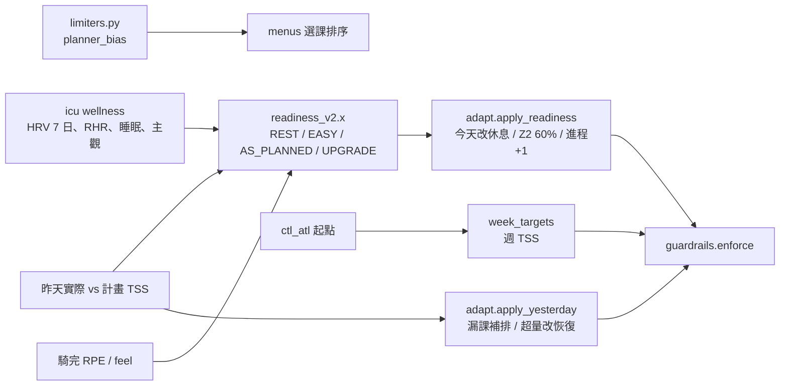
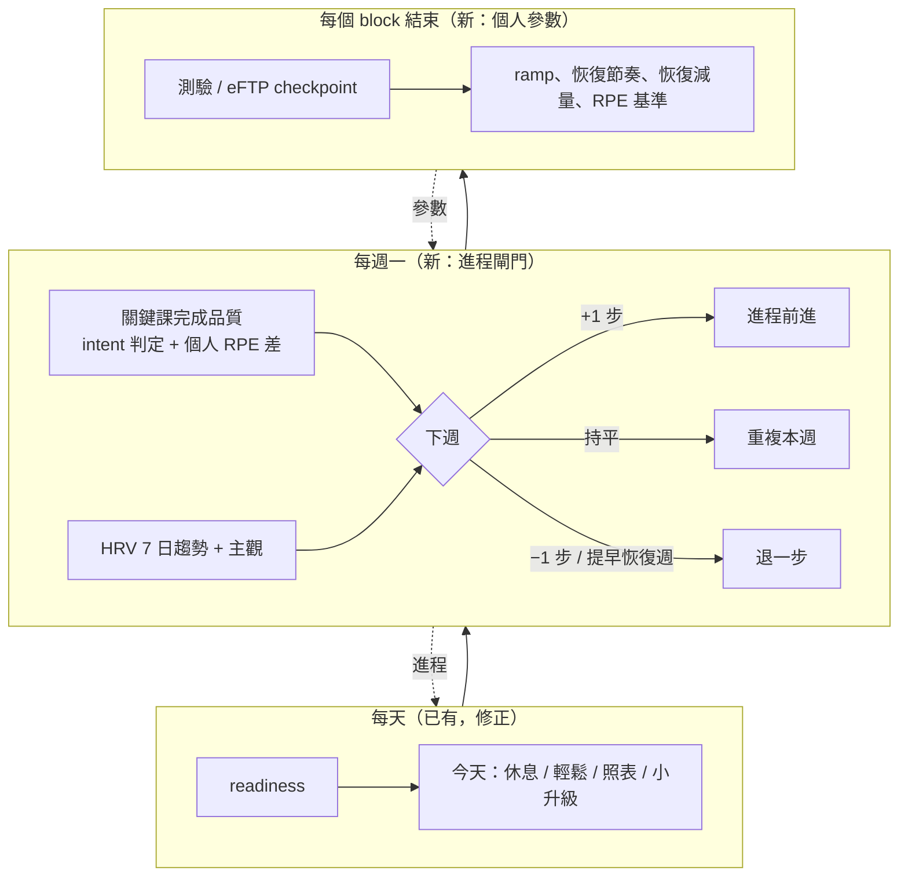

# 適應式課表審查：讓 planner 一次比一次更懂每位騎士

狀態：審查與設計提案（**沒有改任何程式**），2026-10-17。給 Roger 討論用；決定之後才寫 spec / ADR / 程式。
範圍：`src/cyp/planning/`、`src/cyp/analysis/readiness.py`、`analysis/longitudinal/`、ADR-0004 / 0011 / 0012–0014 / 0016、
roger 與 dad 兩個 profile 的實際資料（唯讀，SQLite `mode=ro`；沒有複製資料庫）、文獻到 2026-10。

---

## 0. 結論（先看這段）

1. **最該先修的不是「學習」，是一個回饋迴圈 bug。** 「昨天超過計畫 130 % → 今天改恢復騎」這條規則，
   在 `planning/adapt.py:163`（今天改成 19 TSS 的 `recovery_spin`）和 `analysis/readiness.py:463`
   （今天最多 EASY）**各算一次**。計畫一旦變成 19 TSS，騎士隨便騎 50 TSS 就又是「超量」，隔天又改恢復騎。
   Roger 10/6–10/16 有騎的 9 天裡 **7 天被判超量**；計畫一共 408 TSS，實際騎了 748 TSS；第 1 週的
   每日計畫加總 280 TSS，只有週目標 632 的 44 %。Dad 有騎的 5 天裡 4 天超量。系統以為自己在幫忙恢復，
   其實是把課表變成騎士不會照做的樣子，然後一直判他「做太多」。
2. **「學習」需要的資料目前沒有存。** `planned_workouts.compliance` 欄位在兩個 profile 都是 0 筆
   （從來沒有寫入），每趟的 intent 判定（`ride_intent_v1`）只在產報告時算、不落地。docs/05 §4 寫的每週檢討
   （2/3 週低準備度就提早恢復週、`SET_EFTP` 提案）和 `season.apply_checkpoint()`（checkpoint 沒達標就重做
   兩週）**沒有接上任何呼叫端**。先把「計畫 vs 實際」記下來，才有東西可以學。
3. **個人化分三層、由快到慢：** 每天（已有：readiness、昨天的反應）→ 每週「進程閘門」
   （新：用 A/B 證據的訊號決定下週 +1 步／持平／−1 步／提早恢復週）→ 每個 block 學一次參數
   （新：ramp、恢復週節奏、恢復週減量、RPE 量表；有最少資料量、上下界、往預設值收縮）。
   每一層都是可重播、可解釋的規則（ADR-0004），不是黑箱擬合。
4. **個人化 Banister / Kalman 擬合先只當「報告上的參考」，不驅動課表。** 文獻一致指出 fitness-fatigue
   模型的個人參數辨識度差、交叉驗證下 fatigue 項沒幫助（Marchal 2025、Hellard 2006、Busso 2023），
   以 ADR-0011 的標準只能是 C 級。等我們自己的重播證明它比預設好，再談。
5. **強度上下調的最好證據是「依恢復狀態調整」本身，不是哪個神奇閾值。** 以 HRV＋主觀恢復調整的
   個人化訓練不輸、常常略勝固定課表，而且高強度次數較少（Kiviniemi 2007/2010、Javaloyes 2020、
   Nuuttila 2022、Manresa-Rocamora 2021 統合：效果小、不顯著但一致）。所以：調整「要不要做、做多少」用
   既有 readiness；調整「下週能不能往上」看實際完成品質；長期方向看測驗。

**需要 Roger 決定的事**：見 §7（共 8 題），最重要的三個是：
(a) Phase 0 的超量規則要怎麼改（§5.1 三個選項）；(b) block 級參數變更是自動套用還是在週報按「同意」；
(c) 要不要加一個每週一題「這週強度：太輕／剛好／太重」。

---

## 1. 現在什麼會調、什麼不會調

### 1.1 會隨個人資料改變的（每天 05:30 重排 14 天）



| 訊號 | 影響 | 位置 | 證據 |
|------|------|------|------|
| readiness（HRV 7 日均值、RHR、睡眠、主觀、TSB、騎完 RPE/feel） | 今天 REST → 休息、EASY → Z2 且 ≤ 60 % 原計畫、UPGRADE → 今天進程 +1 步 | `analysis/readiness.py`、`planning/adapt.py:apply_readiness` | 權重與門檻 C/D（docs/research/2026-10.md）；「依恢復調整不輸固定課表」B |
| 昨天漏掉高強度 | 72 h 內找間隔 48 h 的空檔補，否則放掉 | `adapt.reslot_missed_hard` | 間隔 48 h：B− |
| 昨天 > 130 % 計畫 | 今天改恢復騎（而且 readiness 也被壓到 EASY） | `adapt.py:163`、`readiness.py:463` | 沒有文獻，C |
| 昨天 RPE 高於預期 ≥ 3 或 feel 5 | 今天最多 EASY | `readiness.py:444` | D（lit-readiness Claim 5） |
| limiter（durability、VO2 天花板…） | 只改同一 slot 的選課排序 | `menus.py`、`planner._rank` | C |
| 目前 CTL/ATL | 每週 TSS 目標的起點 | `season.week_targets` | 描述性 B |
| 可用時間、日曆事件、年齡、健康旗標 | 每天分鐘上限、取消、masters 上限 | `availability`、`athlete_rules.py` | 設計選擇 |

### 1.2 不會隨個人資料改變的（寫死或只在 athlete.yaml 手動改）

| 常數 | 值 | 位置 | 說明 |
|------|----|------|------|
| CTL ramp 目標 | base/build +4、threshold +2、test −3 /週 | `season.py:45` | 只能被 `planner.ramp_cap` 往下壓，不會因為你吸收得好而往上，也不會因為你吸收得差而往下 |
| 負荷節奏 | 3:1（≥ 60 歲 2:1） | `season.build_skeleton` | 整季固定；docs/05 §2.1 說「readiness 歷史常低就改 2:1」，**沒實作** |
| 恢復週／測驗週減量 | × 0.6 | `season.py:41-42` | 固定 |
| 進程步數 | 每 phase 6 個 loading 週，`progress = (k−1)/5` | `job._progress`、`planner.progression_sequence` | 跟著週數走，不看完成品質；UPGRADE 只動「今天」，不會帶到下次 |
| 每週高強度次數 | phase 預設 1/2/2/1 | `season.py:48` + yaml | 固定 |
| 強度偏好 | easy / moderate / hard 乘數 | `menus.py:94` | onboarding 一次填好，不會學 |
| 預期 RPE | recovery 2、endurance 3、tempo 5、SS 6、threshold 7、VO2 8 | `readiness.py:148` | 所有人同一張表 |
| readiness 分數門檻 | ≥ 65 UPGRADE、45 / 30 | `readiness.py:394` | 所有人相同；只有 baseline（60 天 z）是個人的 |
| 超量判定 | 130 % | `adapt.py:32` | 相對於「當天計畫」，計畫很小時會一直觸發（§2.1） |
| FTP | icu 設定值；不自動改 | docs/05 §4 | 正確（ADR-0004），但 checkpoint 失敗的處理沒接上 |
| guardrails | ramp ≤ 6、TSB ≥ −30、週 TSS ≤ 4 週均 × 1.15、單趟 ≤ 1.6 × 6 週最長 | `guardrails.py` | 都是 C；它們是安全網，**本提案不放寬**任何一條 |

**寫了但沒接上的**（grep 呼叫端為 0）：
- `season.apply_checkpoint()` / `with_progression()`：checkpoint 沒達標要重做兩週。
- docs/05 §4 每週檢討：提早插入恢復週、下個 block ramp −1、`SET_EFTP` 提案。
- `planned_workouts.compliance`：欄位存在（`store/models.py:475`），從未寫入。

---

## 2. 實際資料怎麼說

資料來源：`profiles/<name>/data/cyp.sqlite`，以 `sqlite3 "file:…?mode=ro"` 唯讀查詢；沒有複製或匯出資料庫。
季開始 2026-10-05（Roger）／10-05（dad，profile 10/07 建），所以「計畫 vs 實際」只有約 12 天，
**任何結論都是早期跡象，不是統計**。

### 2.1 Roger（FTP 265、目標 300 W @ 2027-04-02、`planner.mode: apply`）

計畫（最新非 superseded 版）對照實際（同日所有騎乘加總，icu load）：

| 日期 | 計畫 | 計畫 TSS | 實際 TSS | 實際分鐘 | IF | RPE / feel | 判定 |
|------|------|---------:|---------:|---------:|---:|-----------|------|
| 10/06 | ss_3x_n | 47 | 99 | 106 | .75 | – / 2 | 211 % 超量 |
| 10/07 | recovery_spin | 19 | 48 | 62 | .68 | 1 / 2 | 超量 |
| 10/08 | recovery_spin | 19 | 111 | 142 | .69 | 3 / 2 | 超量 |
| 10/09 | recovery_spin | 19 | – | – | – | – | 沒騎 |
| 10/10 | z2_endurance_120 | 88 | 101 | 121 | .71 | 1 / 1 | 115 % |
| 10/11 | z2_endurance_120 | 88 | 75 | 73 | .78 | – | 85 % |
| 10/13 | climb_ss_repeats | 71 | 96 | 104 | .75 | 6 / 3 | 135 % 超量 |
| 10/14 | recovery_spin | 19 | 86 | 79 | .81 | – | 超量 |
| 10/15 | recovery_spin | 19 | 58 | 68 | .72 | 3 / 1 | 超量 |
| 10/16 | recovery_spin | 19 | 74 | 114 | .62 | 1 / 1 | 超量 |
| 10/17 | recovery_spin | 19 | （今天） | | | | |

- 10/14–10/17 每一天的 explanation 第一條理由都是「昨天負荷超過計畫 130 %，今天改恢復」，
  加上「準備度 EASY」。10/8、10/15、10/16 readiness 分數 65 / 55 / 56（本來是 AS_PLANNED 或 UPGRADE），
  是被同一條超量規則壓成 EASY 的。
- **週層級**：第 1 週（10/5 起）週目標 632 TSS，每日計畫加總只有 280（44 %），實際 434（69 %）。
  第 2 週目標 630，到 10/16 為止計畫 235、實際 314。也就是說：**Roger 實際騎的比計畫多，卻比季目標少**；
  計畫被 adapt 一路砍掉，週目標根本沒被追蹤。
- Roger 自己的「輕鬆」是 IF .62–.81、60–140 分鐘。系統排的 45 分鐘 IF ~.50 恢復騎，他一次都沒照騎。
- 主觀：RPE 多為 1–3、feel 1–2（很好）；readiness 19 天裡 8 天 EASY（42 %），其中 3 天是超量規則壓的。
- FTP：icu 設定 265；第一次 ramp test 排在 10/29，第一個 checkpoint 是第 8 週（11/30）272 W。
  每趟 `icu_eftp` 在 9–10 月介於 231–269，噪音大，**現在不能判斷趨勢**。

### 2.2 Dad（69 歲、FTP 200、`2:1`、ramp cap 4/4/3、`hit_days: [tue, thu]`；10/16–10/25 在日本）

| 日期 | 計畫 | 計畫 TSS | 實際 TSS | IF | RPE / feel | 判定 |
|------|------|---------:|---------:|---:|-----------|------|
| 10/08 | z2_endurance_60 | 44 | 50 | .62 | 5 / 1 | 114 % |
| 10/09 | long_ride_distance | 97 | – | – | – | 改到隔天 |
| 10/10 | long_ride_distance | 97 | 146 | .78 | 5 / 3 | 151 % 超量 |
| 10/11 | recovery_spin | 19 | 80 | .71 | – | 超量 |
| 10/13 | tempo_with_surges | 63 | 118 | .79 | 7 / 1 | 187 % 超量 |
| 10/14 | recovery_spin | 19 | 79 | .75 | 5 / 3 | 超量 |

- 同樣的連鎖：5 天有騎、4 天超量；10/15 起的日本行程已正確變成 superseded（沒有排課）。
- **RPE 量表個人差很大**：Dad 15 筆 RPE 的中位數是 5，IF .62 的 Z2 和 IF .92 的短騎都打 5。
  固定的 `EXPECTED_RPE`（endurance 3）會把他每一趟 Z2 都讀成「比預期難 2 分」，再高 1 分就觸發 EASY。
  Roger 則相反，2 小時 IF .71 打 1。同一張表對兩個人是兩種錯。
- Dad 9 月起的週平均 IF 多在 .70–.83（7–8 月 .56–.78），對 69 歲、自述「30 % 喘 70 % Z2」的騎士偏高；
  他的實際行為比 `intensity: moderate` 更硬。這是「學偏好」的好例子，但也是 masters 安全上限要守住的理由。

### 2.3 readiness 和隔天表現

readiness 只從 9/27（Roger 19 筆）、10/7（dad 11 筆）開始存，且混了 v1 / v1.1 / v2 三個版本。
分數和當天騎乘 TSS / 最大 IF 的相關：Roger r = 0.14 / −0.16（n = 13）、dad 0.79 / 0.81（n = 6）。
**樣本太小，不能下結論**；而且 EASY 日的騎乘本來就被計畫壓低，相關是被計畫污染的。
要驗證 readiness 需要用 wellness 歷史（Roger 從 2026-05、dad 從 2025-10）**重播**，
並且看的是「隔天／後兩天的表現指標」（例如固定課的 HR-power、RPE 差），不是當天 TSS。

### 2.4 資料夠不夠「學」

| | Roger | Dad |
|---|---|---|
| 有功率的騎乘 | 113 趟（2026-05 起） | 74 趟（2025-11 起） |
| 有 RPE / feel 的騎乘 | 10 / 8 | 15 / 15 |
| HRV 夜數 | 65 / 149 天 | 16 / 376 天 |
| 有計畫可比對的天數 | 約 10 天 | 約 6 天 |
| 測驗 | 0（第一次 10/29） | 0（健康旗標允許的話依 yaml） |

結論：**現在能學的是「描述性」的個人量表（RPE 基準、輕鬆日習慣、HRV/RHR 基準），不是劑量反應模型。**
劑量反應至少要幾個完整 block 加上 2–3 次測驗才有東西可以比。

---

## 3. 文獻（到 2026-10）

驗證方式同 `.claude/skills/research-review/SKILL.md`：PubMed 記錄以 NCBI E-utilities 依 PMID 取回
（標「摘要（API）」）；姊妹 session 的文獻筆記（`lit-load.md`、`lit-readiness.md`、`lit-tid-periodization.md`，
2026-10-16）已用同方法驗證過的，直接沿用並標「已於 2026-10 審查」。
等級沿用 ADR-0011：A/B 可以下判定，C 只能當參考。

### 3.1 個人化劑量反應模型（Banister、state-space、Bayesian）

| 文獻 | 設計 | 重點 | 對本提案 |
|------|------|------|----------|
| Hellard 2006, J Sports Sci 24(5):509, PMID 16608765（已審查） | 9 名菁英泳者 | τ fitness 38 d（17–59）、τ fatigue 19 d（6–32），參數高度相關、病態 | 個人 τ 估不準 |
| Marchal 2025, Sci Rep 15:3706, PMID 39881202（全文，已審查） | Bayesian + 交叉驗證，短道競速滑冰 | 多數 chain 不收斂；加 fatigue 項交叉驗證 RMSE 沒改善 | 反駁「個人 TSB 能預測」 |
| Busso & Chalencon 2023, MSSE 55(7):1274, PMID 36791017（已審查） | 11 泳者 61 週 | MAPE 2–2.7 %，作者認為不足以規劃個人訓練 | 同上 |
| Busso & Chalencon 2025, EJAP 125(5):1437, PMID 39709585（已審查） | 時變參數（遞迴最小平方） | 能分辨 overreaching 與急性疲勞 | 時變／遞迴更新是值得追的方向（C） |
| Imbach 2022, Sci Rep 12:1586, PMID 35091649（摘要（API）） | 7 名菁英滑冰、時間序列交叉驗證 | 正則化線性模型（ENET）泛化優於 variable dose-response 模型 | 若要做，用簡單正則化模型＋時間序列交叉驗證，不是硬擬 Banister |
| Kolossa 2017, IJCSS 16(2):117, doi 10.1515/ijcss-2017-0010（只看到出版社摘要頁） | Banister 改寫成 state-space＋Kalman filter | 隨新的表現量測修正 fitness/fatigue | 想法可借（每次測驗後更新），未驗證於自行車，**未驗證** |

**判讀**：個人化劑量反應模型目前是 **C**。可以做成週報上的「參考（證據弱）」，不能驅動課表。

### 3.2 依恢復狀態調整強度（HRV / 主觀 / 綜合）

| 文獻 | 設計 | 重點 |
|------|------|------|
| Kiviniemi 2007, EJAP 101(6):743, PMID 17849143（摘要（API）） | RCT，26 名中等體能男性，4 週 | HRV 下降（低於 10 日均值 − SD 或連 2 天下降）→ 低強度或休息；HRV 組 Loadmax 進步較大（0.9 vs 0.5 km/h） |
| Kiviniemi 2010, MSSE 42(7):1355, PMID 20575165（摘要（API）） | RCT，53 人，8 週，自行車測驗 | 男性 HRV 組 Loadmax +30 W vs 固定 +18 W；女性無差；只在 HRV 上升才做高強度的組，每週高強度 1.8 次（vs 2.8–3.3）而成效相同 |
| Javaloyes 2020, JSCR 34(6):1511, PMID 31490431（摘要（API）） | 20 名訓練有素的公路車手，8 週 | HRV 引導 vs block 週期化；（同團隊 2019 IJSPP 亦已於 2026-10 審查） |
| Nuuttila 2022, MSSE 54(10):1690, PMID 35975912（摘要（API）） | 30 名休閒跑者，15 週 | 每週兩次依夜間 HRV＋主觀恢復＋HR-速度指數 **降／持平／升** 負荷；10 km 進步 −6.2 % vs −2.9 %，低反應者 0 % vs 21 % |
| Manresa-Rocamora 2021, IJERPH 18(19):10299, PMID 34639599（摘要（API）；已於 2026-10 審查） | 統合分析 | VO2max、VT2 功率、耐力表現 SMD ≈ 0.20–0.26，偏向 HRV 引導但不顯著 |

**判讀**：「依恢復狀態上下調整，不輸固定課表，且常用較少高強度」→ **B**（與 2026-10 月報一致）。
Nuuttila 2022 的「每週兩次決定降／持平／升」是本提案「進程閘門」最直接的範本。

### 3.3 進程、自主調節、超量與恢復週

| 文獻 | 重點 | 對本提案 |
|------|------|----------|
| Montero & Lundby 2017, J Physiol 595(11):3377, PMID 28133739（摘要（API）） | 78 人；「不反應者」多加每週 120 分鐘後全部有反應 | 停滯時第一個可調的是**劑量**，不是放棄；但對已訓練者外推有限（B−，健康成人） |
| Aubry 2014, MSSE 46(9):1769, PMID 25134000（摘要（API）） | 33 名三鐵；過負荷後 11/23 功能性 overreaching | 急性疲勞但沒掉表現的組，taper 後超補償最大；F-OR 組反而較差、感染 70 % | 「做到表現下降」不是目標；看到表現下降＋高疲勞就該退 |
| Bellinger 2020, Sports Med 50(6):1059, PMID 32064575（摘要（API）） | 綜述 | F-OR 常伴隨較差的適應；不必刻意追求 | 同上 |
| Meeusen 2013, MSSE, PMID 23247672（標題與出處以 API 確認） | ECSS/ACSM 共識 | （本次只確認出處，內容未重讀）過度訓練以表現下降＋排除其他原因判定 | 下調要靠「表現」與「主觀」一起看 |
| Seiler & Sylta 2017, IJSPP 12(S2):S280, PMID 28051345（摘要（API）） | 63 名車手 >1400 次間歇 | 同樣「全力」，4×4 的 RPE 遠高於 4×16 | 預期 RPE 必須依課型（已做）**也依個人**（未做） |
| Inoue 2022, Sports Med Open 8:35（全文；已於 2026-10 審查） | 統合，29 研究 | 教練預期與運動員 RPE 整體一致，但**輕鬆課運動員打得比預期高** | 支持個人 RPE 基準，且固定 +3 門檻是 D |
| Mujika & Padilla 2000, Sports Med 30(2):79, PMID 10966148（摘要（API）） | 綜述 | < 4 週不足刺激，訓練有素者 VO2max 與血量快速下降，近期才訓練者較溫和 | 漏課／旅行回來不必「補」，但超過約 2 週要退 1 步再爬 |
| 3:1 vs 2:1（lit-tid-periodization Claim 5，已審查） | 沒有比較試驗 | 恢復週節奏是慣例，可以個人化而不違反證據 |
| 恢復週減量 40–60 %（同上 Claim 6） | taper 證據 A，套到中途恢復週是外推 C | 減量比例可以個人化 |

### 3.4 Masters（dad）

| 文獻 | 重點 |
|------|------|
| Borges 2018, Exp Aging Res 44(4):338, PMID 29843564（摘要（API）） | 9 名 masters（55.6 歲）vs 8 名年輕車手，6×30 s @175 % PPO：48 h 內**體能恢復速度相同**，但 masters **主觀疲勞恢復較慢** |
| Borges 2017, Clin Auton Res, PMID 28154947（標題以 API 確認；結果來自搜尋摘要，**未驗證**） | 同一 HIIT 後 masters 副交感再活化反而較大 |
| Borges 2025, EJAP, PMID 39212732（標題以 API 確認；結果來自搜尋摘要，**未驗證**） | 連續高強度後，急性反應與初期恢復兩組相近 |

**判讀**：masters 的「主觀」恢復較慢、「客觀」不一定 → dad 的 RPE/feel 基準要個人化，
而 masters 上限（≤ 2 hard、第二個 hard 日改輕、ramp 4/4/3）是設計選擇（C），本提案**保留為硬上限**，
不讓學習放寬。69 歲的資料幾乎都是 55–65 歲的外推，這點要明寫。

### 3.5 ACWR

已於 2026-10 審查（lit-load Claim 5）：ACWR 預測受傷 C，團隊運動為主，Impellizzeri 2021 認為沒有比急性負荷多出資訊。
**本提案不用 ACWR 作任何上下調的觸發**，只保留現有 guardrail 的週 TSS 與單趟上限。

---

## 4. 設計原則

1. **ADR-0004**：所有學到的東西都是「有名字、有上下界、有版本」的參數或規則，同樣輸入得到同樣課表，
   可以用歷史重播。LLM 只負責把結果寫成白話，不算任何數字。
2. **ADR-0011**：只有 A/B 證據支持的訊號可以「判定」並自動改課表方向；C 級的東西只能在既有範圍內微調
   （例如在 B 級支持的「依恢復調整」框架下選步幅），並在報告標「參考（證據弱）」。
3. **學習只往「個人基準」收斂，不往「更硬」漂移**：每個參數有預設值（族群先驗）、上下界、最少資料量；
   資料少時用收縮（shrinkage）拉回預設值：`θ = (n·θ_個人 + k·θ_預設) / (n + k)`。
4. **安全網不學習**：guardrails、masters 上限、健康旗標、REST 規則一律不被學習放寬。
5. **每個改變都要說出原因**：explanation key `plan.learn.<param>`，週報固定一段「這週系統學到什麼」。
6. **先能重播，再上線**：每一層都有 feature flag，flag 關閉時課表與現在 byte-identical（golden test）。

架構上的三層（快 → 慢）：



---

## 5. 分階段提案

### Phase 0：先修迴圈、先存資料（不是新功能，是讓學習有地基）

#### 5.1 超量規則的連鎖（決策 D1）

問題：`actual > 1.3 × planned` 在計畫是 19 TSS 恢復騎時幾乎必然成立；同一事實又在 readiness 被算一次。

| 選項 | 做法 | 優點 | 缺點 |
|------|------|------|------|
| A | 比較對象改成「該日原本的 slot 目標」（adapt 之前的計畫），並加絕對下限：超量 = 實際 > max(1.3 × 原目標, 原目標 + 40 TSS) | 最小改動；恢復騎不再引發連鎖 | 仍然只看單日 |
| B | 看「本週累積」：實際累積 − 計畫累積 > 0.15 × 週目標 才算超量，隔天改輕；單日只在 > 1.5 × 且 > 原目標 + 60 時觸發 | 和週目標一致，符合 Frandsen 2025「單次尖峰比週比例重要」的方向 | 要多一個週累積的狀態 |
| C | 拿掉 readiness 裡的負荷規則（`readiness.py:463`），只留 adapt 一處（A 或 B） | 一個事實只算一次；readiness 回到「身體訊號」 | readiness 解釋少一行 |

**建議：A + C 先上（小、可驗證），B 放 Phase 2 與進程閘門一起做。**
驗收：重播 Roger 10/6–10/16，恢復騎被判超量的次數從 5 降到 ≤ 1；Dad 從 2 降到 0。

#### 5.2 計畫要排騎士「真的會騎」的輕鬆日（決策 D2）

Roger 一次也沒騎過 45 分鐘恢復騎；他的輕鬆日是 60–140 分、IF .62–.81。

| 選項 | 做法 | 取捨 |
|------|------|------|
| A | 學「輕鬆日習慣」：近 28 天非 hard 日的實際 TSS 中位數（收縮到模板預設），恢復日改排 Z2 60–90 分且 IF 上限明寫 | 計畫與實際接近，超量判定才有意義；但恢復日變長 |
| B | 不改計畫，報告提醒「你的輕鬆日偏硬」 | 安全但沒效果（現在就是這樣） |
| C | A，但只在 readiness ≥ AS_PLANNED 且週累積未超前時 | 折衷，較複雜 |

**建議：C**，並在 explanation 說「依你最近 4 週的輕鬆日習慣排 75 分 Z2；強度上限 IF 0.70」。
這也是讓 Roger 的週實際負荷接近週目標的關鍵。Masters（dad）一律不放寬恢復日（他的問題是太硬，不是太短）。

#### 5.3 把「計畫 vs 實際」落地

- 每個 planned day 寫 `compliance`（已有欄位）：`{actual_tss, ratio, intent_verdict, rpe, feel, rpe_delta_personal, skipped}`，
  `intent_verdict` 用既有 `ride_intent_v1`。這是之後所有學習的唯一資料來源。
- 接上 docs/05 §4 的每週檢討與 `apply_checkpoint()`（或在 docs 裡誠實標「未實作」）。
- 一個新的唯讀重播指令（提議，名稱暫定 plan replay，指定起訖日期）：用存好的 wellness / 活動重算 readiness 與計畫，
  輸出每週指標（§6）。不寫任何東西。

### Phase 1：個人量表（描述性、低風險）

| 參數 | 學法 | 最少資料 | 界限 | 用在哪 |
|------|------|----------|------|--------|
| `rpe_offset[class]`：個人 RPE − 表定 RPE | 近 90 天該類課 RPE 中位數 − 表定，收縮 k = 5 | 每類 ≥ 5 筆，否則用全部類別的平均偏差 | ±2 | RPE 意外 = RPE − (表定 + 個人偏差)；dad 的 Z2 預期變 ≈ 5 |
| `feel_baseline` | 近 90 天 feel 中位數 | ≥ 8 筆 | 1–4 | feel 只在「比自己平常差 ≥ 2」才算差 |
| `easy_day_tss` | 近 28 天非 hard 日實際 TSS 中位數 | ≥ 6 天 | 模板預設 × [1, 1.8]；masters 上界 1.0 | 5.2 |
| HRV / RHR / 睡眠基準 | 已有（60 天 z） | – | – | 不變 |

證據：個人 RPE 基準 B−（Inoue 2022、Seiler 2017 支持「RPE 依人依課型不同」），具體收縮 k 與 ±2 是 C。
報告：「你的 Z2 平常打 5，這趟打 5 是正常的」。

### Phase 2：每週進程閘門（強度／負荷何時上、何時下）

每週一（或週日晚）對**下週**做一次決定，範本是 Nuuttila 2022 的「降／持平／升」。只看 A/B 訊號：

輸入（上週）：
- **Q 關鍵課品質**：hard／long slot 的 `intent_verdict`（達標／部分／未達）與個人化 RPE 差。
- **R 恢復狀態**：HRV 7 日均值相對基準（ADR-0013 的帶狀）、主觀疲勞／痠痛、readiness 中 EASY/REST 天數。
- **C 完成率**：實際 / 週目標 TSS。

| 結果 | 條件（全部成立） | 下週動作 |
|------|------------------|----------|
| **升** | 關鍵課 ≥ 2/2 達標、平均個人 RPE 差 ≤ 0、HRV 帶內或以上、EASY/REST ≤ 1 天、完成率 0.85–1.15 | 進程 +1 步（正常前進）；若連 2 週「升」且 RPE 差 ≤ −1 → 額外 +1 步（上限：同一 block 最多額外 +2） |
| **持平** | 不符合升也不符合降 | 進程不前進（重複本週參數），週 TSS 目標照 season |
| **降** | 任一：關鍵課 ≥ 2 次未達標且 RPE 差 ≥ +2；HRV 7 日均值低於帶狀連 ≥ 5 天；EASY/REST ≥ 3 天 | 進程 −1 步、週 TSS × 0.85 |
| **提早恢復週** | 連 2 週「降」，或「降」＋主觀疲勞 z ≥ +1.5 | 下週改恢復週（× 0.6），之後重排 block（節奏從這週重算） |
| **旅行／中斷** | 連續 ≥ 10 天幾乎沒騎（Dad 10/16–10/25） | 回來第一週持平且 −1 步；> 21 天 −2 步（Mujika 2000） |

設計重點：
- 「升」的步幅是 **進程步**，不是 FTP 或 TSS 的百分比；所以它永遠落在模板的 `params` 範圍內，guardrails 照跑。
- 每日的 UPGRADE 只動當天；**閘門才是讓「做得好」累積的地方**。現在 UPGRADE 做得再好，下週還是從原進度開始。
- 「降」優先調強度（進程）而非直接砍量，符合 masters 文獻「少一次 hard 而不是全面降強度」；
  dad 的第二個 hard 日在「降」時直接改 tempo（已有 `LIGHT_HIT`）。
- 證據：「依恢復上下調整」B；各門檻（2/2、+2、5 天、×0.85）是 C，要在 ADR 裡寫成設計選擇並交給重播驗證。

#### 決策 D3：閘門結果是自動套用還是需要同意？

| 選項 | 說明 | 取捨 |
|------|------|------|
| A | 全自動，週報說明 | 最省事；錯了要等下週才修 |
| B | 「升」「持平」「降」自動；「提早恢復週」和「額外 +1」在週報／web 按同意（48 h 沒回應 → 採保守那個） | 安全且不卡住流程 |
| C | 全部要同意 | 最安全，但 dad 不會去按 |

**建議：B**。dad 的 profile 可以預設「沒回應 = 保守」。

### Phase 3：每個 block 學一次的個人參數

在 block 結束（有測驗或 eFTP checkpoint）時，提出下一個 block 的參數；**提案、不自動**（ADR-0011 第 3 點：改門檻要 ADR／人批准）。

| 參數 | 預設 | 學法 | 最少資料 | 界限 |
|------|------|------|----------|------|
| `ramp_target[phase]` | 4 / 4 / 2 | 上個 block 的「升」週比例高且 checkpoint 達標 → +0.5；「降」週 ≥ 2 或 checkpoint 未達 → −0.5 | 1 個完整 block + 1 次測驗 | 不超過 `planner.ramp_cap` 與 guardrail；masters 不超過 4/4/3 |
| `load_pattern` | 3:1（≥60：2:1） | block 內「降」或提早恢復週 ≥ 2 次 → 改 2:1；2:1 下連 2 個 block 都沒「降」→ 提議回 3:1 | 2 個 block | masters 只能 2:1 |
| 恢復週減量 | × 0.6 | 恢復週後第一週 HRV 仍低於帶狀 → × 0.5；恢復週後 RPE 差 ≤ −1 且 HRV 帶上 → × 0.7 | 2 次恢復週 | 0.5–0.7 |
| `intensity` 偏好 | yaml | 實際 hard 課的 RPE 差與 like/dislike（workout-variety spec 的喜歡／不想再騎） | 8 次 hard 課 | 只在 easy/moderate/hard 間移一格；只改選課，不改劑量 |
| checkpoint 處理 | 未接上 | 接上 `apply_checkpoint`：未達 > 3 % → 重做兩週；連兩次未達 → 提議「誠實重訂目標」（docs/05 §2.4 已寫） | 測驗 | – |

決策 D4：學到的參數住哪？

| 選項 | 取捨 |
|------|------|
| A 新表 `learned_params(athlete, param, value, n, as_of, algo_version, approved_by)` | 可追溯、可回滾、和 yaml 分開；**建議** |
| B 直接寫回 `athlete.yaml` | 簡單，但「人寫的」和「學的」混在一起，profile 隔離與 git-ignore 都 OK，但難回滾 |
| C 每次即時從歷史算、不存 | 最純，但 block 級決定需要「被批准」的狀態，存不下來 |

優先順序：yaml 明寫的值 > 已批准的 learned 值 > 預設。

### Phase 4（可選、研究性）：個人劑量反應模型只做報告

- 每月用 Roger 的歷史擬合一個**有收縮的**簡單模型（例如 τ 固定 42/7、只估 k1/k2；或 Imbach 2022 式的正則化線性模型），
  以時間序列交叉驗證和「預設 τ」比。
- 只有在重播中預測測驗結果的誤差**明顯小於**預設（例如 MAPE 低 ≥ 20 %、至少 3 次測驗）才在報告露出，標 C 級。
- 永遠不驅動週 TSS。若未來要驅動，另寫 ADR。

---

## 6. 解釋、安全與驗證

### 6.1 報告怎麼說

- 每日（已有格式）：`plan.adapt.*` 之外加 `plan.learn.<param>`：「依你最近 4 週的輕鬆日習慣（中位數 74 TSS，n = 9）排 75 分 Z2」。
- 週報（digest-reports spec）新增一段「這週系統學到什麼 / 下週怎麼調」：
  閘門結果（升／持平／降）、三個輸入的值、哪一條規則觸發、證據等級；需要同意的項目附按鈕（web）或回信說明。
- 月報：個人參數表（目前值、預設、n、上次變更），以及 Phase 4 模型（若有）標「參考（證據弱）」。
- 所有數字由程式算出，LLM 只改寫句子（ADR-0004）。

### 6.2 安全

- 不變：guardrails 全部、masters 上限、健康旗標、REST 規則、寫入路徑（`publish_plan`）、`needs_review` 不寫入。
- 新增：學習值有硬上下界；同一參數每 block 最多變一次；每週閘門最多 ±1 步（例外：額外 +1 要同意）。
- 回滾：一個重設單一學習參數的 profile 指令（提議，之後再設計），flag 關閉即回到現狀。
- masters：學習只能讓 dad 的計畫**更保守或持平**，不能更硬（除了選課偏好）。

### 6.3 驗證（上線前）

重播 Roger 2026-05 至今、dad 2025-11 至今（readiness 用 wellness 重算；計畫用當時的 config 重跑；無網路、不寫日曆）：

| 指標 | 目前（10/6–10/16 實測） | 目標 |
|------|------------------------|------|
| 被判「超量」的有騎日比例 | Roger 7/9、dad 4/5 | ≤ 20 % |
| 每日計畫加總 / 週目標（非恢復週） | Roger 44 % | 0.85–1.0 |
| 實際 / 週目標 | Roger 69 % | 0.85–1.15 |
| 計畫 churn（同一天被改的次數） | Roger 10/16 改到第 6 版 | 每天 ≤ 2 版 |
| guardrail 違規（修正後） | – | 0 |
| 閘門「降」之後 2 週的 HRV / RPE 是否回到帶內 | – | ≥ 70 %（描述性） |
| checkpoint（長期） | 第一次 11/30 | 報告實測 vs 預期，不當驗收門檻 |

另外加模擬：docs/05 §8 的 Banister responder 加「騎士習慣偏硬」「RPE 偏高」「旅行 10 天」三種 persona，
斷言閘門不會連續升級到 guardrail 邊緣、不會在旅行後立刻恢復原進度。

---

## 7. 要 Roger 決定的問題

1. **D1 超量規則**：A + C 先修（建議），還是直接做 B（週累積）？
2. **D2 輕鬆日**：要不要依你的實際習慣排 60–90 分 Z2，而不是 45 分恢復騎？你騎「恢復日」時心裡的目標是什麼？
3. **D3 自動程度**：每週閘門「升／持平／降」自動、「提早恢復週」和「額外 +1」要你按同意（建議）？dad 沒回應時預設保守可以嗎？
4. **新的回饋題目**：要不要在週報或 web 加一題「這週強度：太輕／剛好／太重」？（這是最便宜、最直接的個人化訊號，但 dad 要願意回答。）
5. **D4 學到的參數**存新表（建議）還是寫回 `athlete.yaml`？
6. **Dad 的強度**：他實際比 `moderate` 硬（9 月起週平均 IF .70–.83）。系統要「跟著他」（選課偏好往 hard 移一格）還是「拉住他」（維持 masters 保守，報告提醒）？我建議拉住，但這是家人之間的決定。
7. **Phase 4**：要不要投資個人劑量反應模型（只做報告）？以文獻來看預期效益低，我建議等有 3 次以上測驗再說。
8. **readiness 驗證**：同意先做唯讀的 `plan replay`，用 5 月以來的資料驗證 readiness 和閘門，再開任何新 flag？

---

## 8. 需要的後續文件（決定後）

- 新 spec「adaptive-planning」（放在 docs/specs 下）（Phase 0–3 的規格，含 flag：`plan.overdone_v2`、`plan.easy_habit`、`plan.progression_gate`、`plan.learned_params`）。
- ADR：超量判定改寫（取代現行 130 % 規則）；每週進程閘門；個人參數學習與界限。
- `core/evidence.py` 新 claim（status proposed、C）：`adapt.overdone_rule`、`progression_gate.thresholds`、`learned.rpe_offset`、`learned.easy_habit`；
  B：`progression_gate.recovery_guided`（引用 Kiviniemi 2007/2010、Nuuttila 2022、Manresa-Rocamora 2021）。
- docs/05 §3–§4 改寫為實際行為（目前 §4 描述了未實作的功能）。

## 附錄 A：查詢

```sql
-- 計畫 vs 實際（每個 profile，sqlite3 "file:profiles/<p>/data/cyp.sqlite?mode=ro"）
with pl as (select date_local d, template_id, round(target_tss) ptss from planned_workouts where status!='superseded'),
ac as (select substr(start_local,1,10) d, round(sum(icu_training_load)) atss, max(icu_rpe) rpe, max(feel) feel
       from activities where is_ride=1 group by 1)
select pl.d, template_id, ptss, atss, rpe, feel from pl left join ac on pl.d = ac.d order by 1;
-- compliance 從未寫入
select count(*), sum(compliance is not null) from planned_workouts;   -- roger 22|0, dad 25|0
-- 週目標
select week_start, target_tss from week_plans;
```

## 附錄 B：文獻驗證狀態

| 文獻 | PMID / DOI | 讀了什麼 |
|------|-----------|----------|
| Montero & Lundby 2017 | 28133739 / 10.1113/JP273480 | 摘要（API） |
| Imbach 2022 | 35091649 / 10.1038/s41598-022-05392-8 | 摘要（API） |
| Kiviniemi 2007 | 17849143 / 10.1007/s00421-007-0552-2 | 摘要（API） |
| Kiviniemi 2010 | 20575165 / 10.1249/mss.0b013e3181cd5f39 | 摘要（API） |
| Javaloyes 2020 | 31490431 / 10.1519/JSC.0000000000003337 | 摘要（API，結果段被截斷） |
| Nuuttila 2022 | 35975912 / 10.1249/MSS.0000000000002968 | 摘要（API） |
| Manresa-Rocamora 2021 | 34639599 / 10.3390/ijerph181910299 | 摘要（API） |
| Aubry 2014 | 25134000 / 10.1249/MSS.0000000000000301 | 摘要（API） |
| Bellinger 2020 | 32064575 / 10.1007/s40279-020-01269-w | 摘要（API） |
| Meeusen 2013 | 23247672 / 10.1249/MSS.0b013e318279a10a | 只確認標題與出處 |
| Seiler & Sylta 2017 | 28051345 / 10.1123/ijspp.2016-0464 | 摘要（API） |
| Mujika & Padilla 2000 | 10966148 / 10.2165/00007256-200030020-00002 | 摘要（API） |
| Borges 2018 | 29843564 / 10.1080/0361073X.2018.1477361 | 摘要（API） |
| Borges 2017 / 2025 | 28154947 / 39212732 | 只確認標題與出處 |
| Kolossa 2017 | 10.1515/ijcss-2017-0010 | **未驗證**（只有搜尋摘要，未開出版社頁） |
| Hellard 2006、Marchal 2025、Busso 2023/2025、Inoue 2022、Frandsen 2025 | 見 lit-load / lit-readiness 筆記 | 2026-10-16 已審查 |
